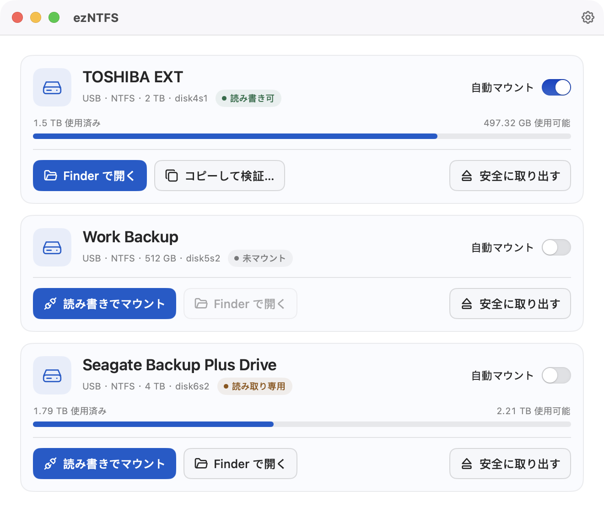

# ezNTFS

[English](README.md) · [简体中文](README.zh-CN.md) · 日本語

ezNTFS は、macOS で外付け NTFS ディスクを読み書きするためのアプリです。NTFS-3G と macFUSE を使用し、ディスクごとの自動マウント、安全な取り出し、SHA-256 でのコピー検証に対応しています。

[公式サイト](https://ixiehao.github.io/ezNTFS/ja/) · [Mac 版のダウンロード](https://github.com/ixiehao/ezNTFS/releases/latest) · [問題を報告](https://github.com/ixiehao/ezNTFS/issues)

## 動作環境

- macOS 14 以降を搭載した Apple Silicon Mac。
- 公式インストーラからインストールした [macFUSE 5.5.0](https://macfuse.github.io/)。
- ezNTFS の PKG からアプリ、マウントサービス、NTFS-3G ドライバをインストールするための管理者権限。
- 0.5.0 のアプリと同梱の実行ファイルは ad-hoc 署名済みです。PKG は未署名で、Apple の公証は受けていません。リリースページに SHA-256 チェックサムがあります。

## 使い方

1. 外付け NTFS ディスクを接続し、ディスクのカードまたはメニューバーから「読み書きでマウント」を選びます。別のドライバがそのボリュームを管理している場合は、先に通常の手順でアンマウントしてください。
2. 自動マウントを使うには、設定で「接続時に自動マウント」を有効にし、対象ディスクの「自動マウント」をオンにします。安定した識別子のないディスクは手動でマウントできます。
3. 「コピーして検証」は、通常のファイルやフォルダを順にコピーし、その内容を読み戻してファイルごとの SHA-256 を照合します。全件の検証を通過すると、新しいフォルダに結果をまとめます。空のファイルとフォルダにも対応します。日付や拡張属性の保持はドライバの対応に依存します。macOS のすべてのアクセス権、ハードリンク構造、特殊ファイルの保持は対象外です。
4. 使用後はディスク上のファイルを閉じ、「安全に取り出す」を選びます。物理ディスクと、含まれるすべてのボリュームが取り出されます。使用中の表示が出たら、ディスクを使用しているウインドウやアプリを閉じてからやり直してください。
5. メインウインドウを閉じても、ezNTFS はメニューバーに残ります。「ezNTFS を開く」でウインドウを表示し、「ezNTFS を終了」で終了します。

## 設定とトラブルシューティング

- メニューバーの「言語」から、システムに従う、英語、簡体字中国語、日本語を選べます。インストーラとシステムダイアログには macOS の言語設定が使われます。
- 「ヘルプ → アップデートを確認」で、GitHub の最新の公開安定版を確認できます。新しいバージョンが見つかると、ヘルプとステータスメニューに「リリースを表示」が追加されます。
- 「ヘルプ → 依存ツールを確認…」と設定の「動作環境の確認」では、同じパネルで macFUSE、NTFS-3G、マウントサービスの状態を確認できます。macOS にディスクへの直接アクセスを拒否された場合は、アプリのボタンから「フルディスクアクセス」の設定を開き、マウントサービスを追加してください。[プライバシーとアクセス権](docs/PRIVACY.md)
- ドライバをアップデートまたは修復する前に、ファイルを閉じ、Finder または ezNTFS ですべての外付けディスクを安全に取り出してから、インストーラを開き直してください。インストールが完了したら再接続できます。

## 開発

[ドキュメント](docs/README.md) · [ビルド](docs/DEVELOPMENT.md) · [テスト](docs/QA.md) · [リリース](docs/RELEASING.md) · [貢献](CONTRIBUTING.md) · [セキュリティ](SECURITY.md)

ezNTFS は [MIT ライセンス](LICENSE)で公開されています。NTFS-3G、macFUSE、Tabler Icons のライセンスについては、[サードパーティ製コンポーネント](docs/THIRD_PARTY.md)をご覧ください。
