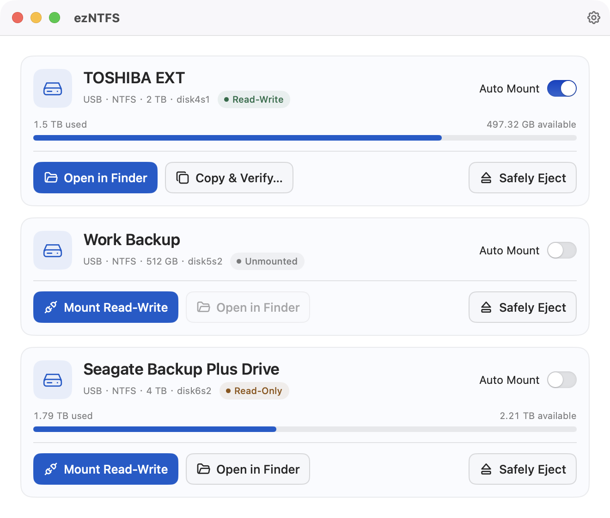

# ezNTFS

English · [简体中文](README.zh-CN.md) · [日本語](README.ja.md)

Read and write NTFS external drives in Finder, with the drive’s existing format intact. ezNTFS is free and open source. It uses NTFS-3G and macFUSE.

[Download 0.5.2 for Apple Silicon](https://github.com/ixiehao/ezNTFS/releases/download/v0.5.2/ezNTFS-0.5.2-arm64.pkg) · [Intel preview](https://github.com/ixiehao/ezNTFS/releases/tag/v0.5.2-intel.1) · [Release notes and checksums](https://github.com/ixiehao/ezNTFS/releases/tag/v0.5.2) · [ezNTFS official website](https://ixiehao.github.io/ezNTFS/)

## Install

The stable release requires an Apple Silicon Mac with macOS 14 or later.

1. Close files on your external drives and safely eject the drives before running the installer.
2. macFUSE 5.5.0 is a one-time install. If it’s already on your Mac, go straight to the ezNTFS PKG. [Get macFUSE 5.5.0](https://github.com/macfuse/macfuse/releases/tag/macfuse-5.5.0)
3. Open the ezNTFS PKG and approve installation in macOS.

The app and its executables are ad-hoc signed. The PKG is unsigned and has no Apple notarization.

## Use

- **Mount Read-Write** lets you use the drive in Finder. Unmount it first if another NTFS driver is using it.
- For automatic mounting, turn on **Mount on Connection** in Settings and **Auto Mount** for the drive. Use manual mounting for drives without a stable identifier.
- **Copy & Verify** checks each copy with SHA-256 and puts the batch in a new folder once it passes. It handles regular files and folders, including empty ones. Dates and extended attributes depend on driver support. Full macOS permissions, hard-link relationships and special files are outside its scope.
- Close open files before choosing **Safely Eject**. This ejects the whole drive, including all its volumes. If it’s busy, close the windows or apps using it and retry.

Closing the window leaves ezNTFS in the menu bar. Choose **Open ezNTFS** to bring it back.

## Help

- If macOS blocks disk access, open **Help → Check Dependencies**. Use **Open Privacy Settings** and **Copy Service Path** to add the mount service to Full Disk Access. [Privacy and permissions](docs/PRIVACY.md)
- Use **Help → Check for Updates** for the latest stable release. Choose your preferred language from the **Language** menu. [Report an issue](https://github.com/ixiehao/ezNTFS/issues)

## Development

[Documentation](docs/README.md) · [Build](docs/DEVELOPMENT.md) · [Testing](docs/QA.md) · [Releasing](docs/RELEASING.md) · [Contributing](CONTRIBUTING.md) · [Security](SECURITY.md)

[MIT License](LICENSE) · [Third-party components](docs/THIRD_PARTY.md)
