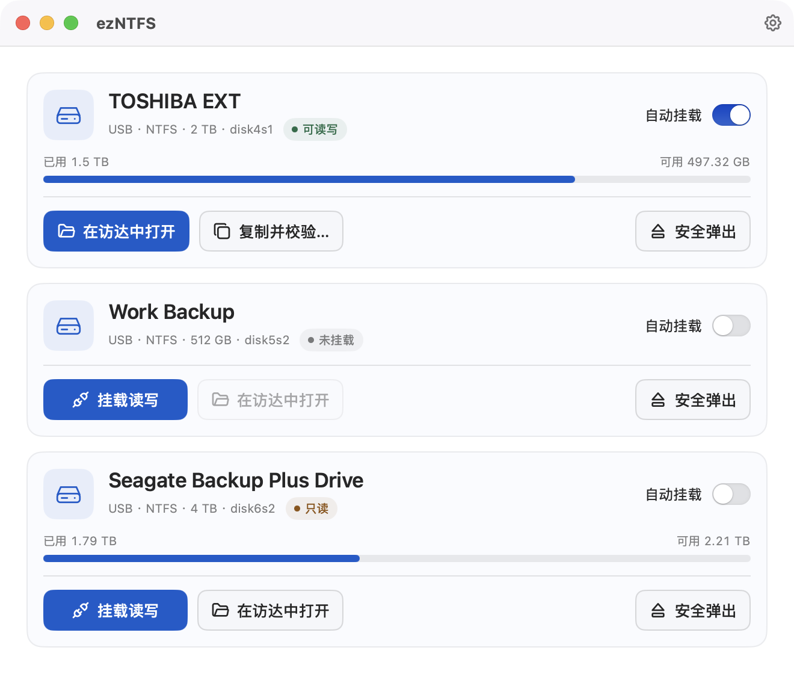

# ezNTFS

[English](README.md) · 简体中文 · [日本語](README.ja.md)

ezNTFS 是一款免费开源的 Mac NTFS 硬盘读写工具。它通过 NTFS-3G 和 macFUSE 挂载 NTFS 移动硬盘，保留原有格式，让你在访达中写入文件。支持逐盘自动挂载、安全弹出和复制后逐文件 SHA-256 校验。

[官方网站](https://ixiehao.github.io/ezNTFS/zh/) · [下载 Mac 版 0.5.1](https://github.com/ixiehao/ezNTFS/releases/download/v0.5.1/ezNTFS-0.5.1-arm64.pkg) · [发布说明与校验和](https://github.com/ixiehao/ezNTFS/releases/tag/v0.5.1) · [反馈问题](https://github.com/ixiehao/ezNTFS/issues)

## 安装要求

- Apple Silicon Mac，系统为 macOS 14 或更新版本。
- ezNTFS 安装器会自动检查 macFUSE 5.5.0。已经安装时直接继续。缺少时，只需从 [macFUSE 5.5.0 官方发布页](https://github.com/macfuse/macfuse/releases/tag/macfuse-5.5.0)安装一次，升级 ezNTFS 时可以继续使用。
- 按 macOS 提示授权 ezNTFS PKG 安装主 App、系统挂载服务和 NTFS-3G 驱动。
- App 与随附可执行文件使用 ad-hoc 签名。PKG 本身未签名，也未公证。SHA-256 校验文件见发布页。

## 使用

1. 连接外置 NTFS 硬盘，在硬盘卡片或菜单栏选择「挂载读写」。如果卷由其他驱动管理，先正常卸载该卷。
2. 如需自动挂载，在设置中打开「插盘后自动挂载」，再开启指定硬盘的「自动挂载」。缺少稳定标识的硬盘可手动挂载。
3. 「复制并校验」依次复制普通文件和目录，再读回副本并逐个校验 SHA-256。整批通过后交付到新文件夹。支持空文件与空目录，文件日期和扩展属性使用当前驱动的元数据支持。完整的 macOS 权限、硬链接结构与特殊文件超出复制范围。
4. 使用完毕后关闭盘上的文件，点「安全弹出」。这会弹出整块物理盘及其所有卷。如果 macOS 提示磁盘正在使用，关闭占用它的窗口或应用后重试。
5. 关闭主窗口后，ezNTFS 在菜单栏继续运行。点击「打开 ezNTFS」恢复窗口，或选择「退出 ezNTFS」结束运行。

## 设置与排查

- 顶层「语言」菜单提供跟随系统、英语、简体中文和日语。安装器和系统对话框使用 macOS 的语言设置。
- 「帮助 → 检查更新」查询 GitHub 公开稳定版。发现新版后，「帮助」和状态菜单会显示独立的「查看发布页」入口。
- 「帮助 → 检查依赖…」与设置中的「环境检查」打开同一面板，显示 macFUSE、NTFS-3G 和挂载服务。若 macOS 拒绝原始磁盘访问，通过「打开权限设置」和「复制组件路径」，将挂载服务添加到「完全磁盘访问权限」。详见[隐私与权限](docs/PRIVACY.md)。
- 升级或修复驱动前，关闭移动硬盘上的文件，在访达或 ezNTFS 中安全弹出所有移动硬盘，再重新运行安装包。安装完成后可重新连接。

## 开发

[文档导航](docs/README.md) · [构建](docs/DEVELOPMENT.md) · [测试](docs/QA.md) · [发布](docs/RELEASING.md) · [参与开发](CONTRIBUTING.md) · [安全](SECURITY.md)

ezNTFS 使用 [MIT 许可证](LICENSE)。NTFS-3G、macFUSE 和 Tabler Icons 的许可证见[第三方组件](docs/THIRD_PARTY.md)。
