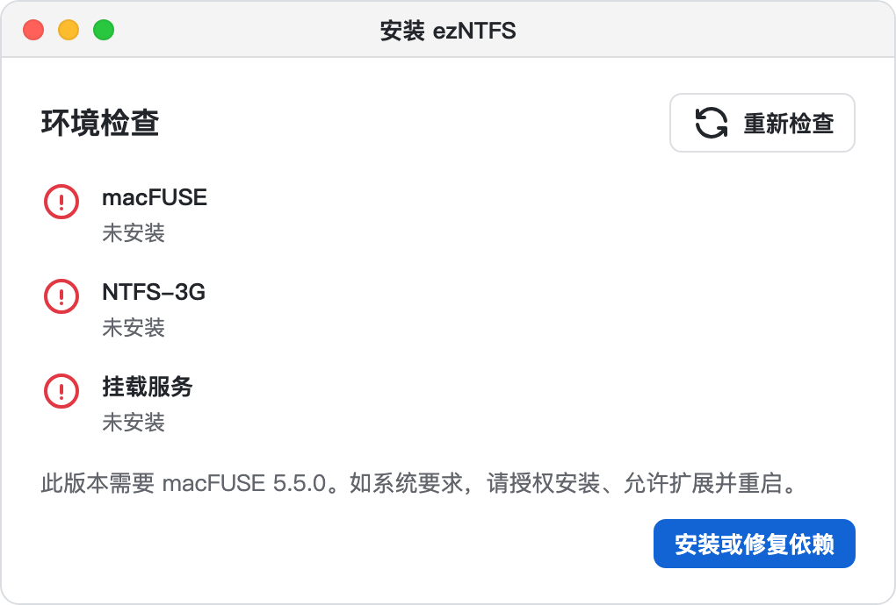
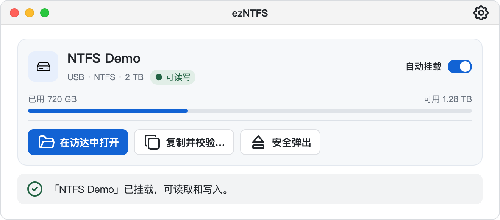

# 在 Intel Mac 上安装 ezNTFS

Intel 正式版支持 macOS 12.7 Monterey 或更新版本。先在「 → 关于本机」确认这台 Mac 显示的是 Intel 处理器。[下载 Intel 正式版](https://github.com/ixiehao/ezNTFS/releases/download/v0.5.3/ezNTFS-0.5.3-x86_64-Monterey-Setup.zip)

## 1. 打开安装引导

如果正在使用移动硬盘，先关闭盘上的文件并安全弹出。解压下载的 ZIP，在访达中打开「Install ezNTFS」。Monterey 如果提示无法验证开发者，可在「系统偏好设置 → 安全性与隐私 → 通用」为这个安装引导点「仍要打开」，再按提示确认。

## 2. 点「安装或修复依赖」

安装引导会检查 macFUSE、NTFS-3G 和挂载服务。缺少 macFUSE 时，会下载并验证 macFUSE 5.5.0，再打开官方图形安装器。官方来源连接不通时会自动尝试镜像；已经装好兼容版本时会跳过这一步。

macFUSE 安装成功后，关闭它的安装窗口。接着按提示安装 ezNTFS，输入管理员密码后等安装完成，最后在引导窗口点「打开 ezNTFS」。

## 3. 首次挂载时允许 macFUSE 扩展

插入 NTFS 硬盘。如果出现「System Extension Blocked」，在 Monterey 打开「系统偏好设置 → 安全性与隐私 → 通用」，解锁左下角的锁，允许来自 **Benjamin Fleischer** 的系统软件。遇到重启提示时，重启后再打开 ezNTFS。[macFUSE 官方安装说明](https://github.com/macfuse/macfuse/wiki/Getting-Started#allow-the-macfuse-kernel-extension-to-load-apple-silicon-and-intel-macs)

如果 ezNTFS 单独提示磁盘访问权限不足，按应用提示把挂载服务加入「完全磁盘访问权限」，再回到 ezNTFS 重试。[隐私与权限](PRIVACY.md)

## 4. 确认可读写，使用后安全弹出

插入硬盘后，等卡片显示「可读写」，再点「在访达中打开」。可以新建一个临时测试文件，打开确认后将它删除。如果硬盘仍显示「只读」，检查卡片上的「自动挂载」，或者点「挂载读写」。

关闭硬盘上的文件后点「安全弹出」，等 ezNTFS 确认，再拔下连接线。两张配图均按应用界面重绘，盘名和容量为演示数据。
